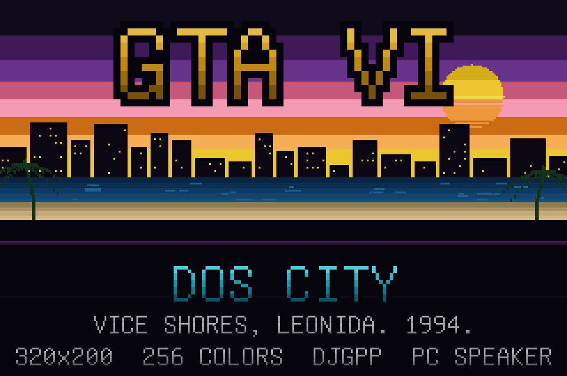
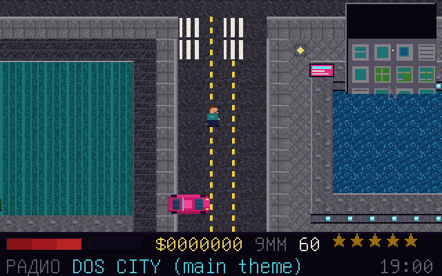
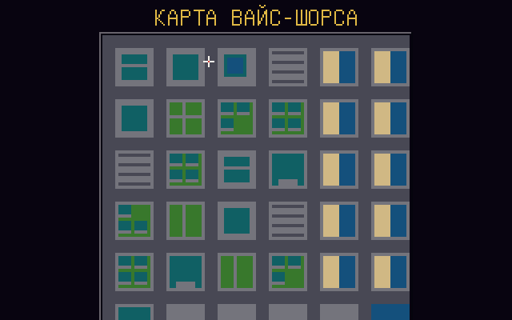

<p align="center">
  
</p>

<p align="center">
  <b>Демейк-пародия на игру, которой ещё нет, для платформы, которой уже нет.</b><br>
  320×200 · 256 цветов · Mode 13h · DJGPP · PC speaker · один бит звука
</p>

<p align="center">
  <a href="#сборка"></a>
  
  
  
  <a href="LICENSE"></a>
</p>

```
Вайс-Шорс, Леонида.
Город, где каждый второй — чей-то двоюродный брат.
Ты приехал сюда за деньгами.
Деньги приехали раньше.
Они уже купили себе дом.
```

---

## Что это

Вид сверху, как в GTA 1, только в 1994 году и на 486. Город 96×96 тайлов
(1536×1536 пикселей), семь сюжетных заданий, полиция с розыском, пешеходы,
трафик, радио из шести станций и полноценный PC-speaker-трекер.

Ни одного бинарного ассета: вся графика, музыка и текст генерируются
Python-скриптами из исходников. В репозитории нет ни одного `.png` игры,
ни одного `.wav` — только код, который их придумывает.

| | |
|---|---|
| **Город** | 1536×1536 px, 6 районов: даунтаун, пригород, пляж, доки, парк, промзона |
| **Сюжет** | 7 заданий: чемодан, три посылки, угнанная машина, стрелка на доках, ограбление, побег в аэропорт, эпилог |
| **Механика** | ходьба, бег, машины с 16 курсами, ручник, стрельба, розыск 5 уровней, угон |
| **Звук** | 1-битный секвенсор: 6 песен, 16 эффектов, сирена, двигатель |
| **Экраны** | титул, интро, игра, пауза, карта, радио, управление, об игре, смерть, арест, задание выполнено, титры |
| **Состояние** | сохранение/загрузка в `GTA6.SAV` |

<p align="center">
  
  
</p>

## Сборка

Нужен Python 3 и предсобранный DJGPP. Всё остальное скачивается.

```powershell
python tools\setup.py          # один раз: DJGPP + CWSDPMI + Unifont
python tools\build.py dos      # -> dist\GTA6DOS.EXE
python tools\build.py host     # нативная сборка для отладки (PPM-кадры)
```

Если рядом лежит проект `DOSYA` с уже скачанным `vendor\`, `setup.py` не будет
качать 130 МБ заново — возьмёт оттуда. Переопределяется через `GTA_VENDOR`.

`dist\` после сборки:

```
GTA6DOS.EXE   сама игра
CWSDPMI.EXE   DPMI-хост (нужен, если в системе нет своего)
RADIO\*.MID   те же песни, что играет пищалка, но в MIDI
```

Запуск в DOSBox:

```
mount c dist
c:
GTA6DOS.EXE
```

Или сразу: `dosbox -conf dosbox.conf`.

## Управление

| Клавиша | Пешком | В машине |
|---|---|---|
| Стрелки / WASD | идти | газ / тормоз / руль |
| Shift | бежать | — |
| Пробел | стрелять | ручник |
| Ввод | сесть в машину | выйти |
| H | — | сигнал (разгоняет пешеходов) |
| Tab | следующая радиостанция | то же |
| M | карта | карта |
| F1 | подсказка | подсказка |
| Esc | пауза | пауза |

Стрельба автоматическая при удержании, с задержкой между выстрелами.
Патроны кончаются, здоровье тоже.

## Как это устроено

Всё в `src/`, никаких зависимостей кроме libc DJGPP.

| файл | что делает |
|---|---|
| `video.c` | Mode 13h, PIT на 1 кГц, IRQ1-обработчик клавиатуры. Два бэкенда: настоящий DOS и «host» для отладки без DOSBox. |
| `render.c` | Софтверный рендер: спрайты, тайлы, шрифт, градиенты, рамки. Пишет в один 8-битный буфер. |
| `sound.c` | 1-битный секвенсор: PC speaker, PIT канал 2, шум через LCG. |
| `g_world.c` | Карта, камера, RNG, спавн, сортировка и отрисовка сущностей. |
| `g_play.c` | Игрок, машины, пешеходы, полиция, пули, пикапы. 8.8 fixed point. |
| `g_mission.c` | Семь заданий, цели, диалоги, маркеры. |
| `g_ui.c` | HUD, мини-карта, меню, карта, диалоговое окно, сохранение. |
| `game.c` | Автомат состояний, раскладка ввода, автопилот. |
| `main.c` | Цикл с фиксированным шагом 60 Гц. |

Подробности — в [docs/ARCHITECTURE.md](docs/ARCHITECTURE.md).

### Три слоя города

Город рисуется в три прохода:

1. земля — все не-крыши;
2. здания: под каждой крышей сначала рисуется её же текстура на 6 пикселей
   ниже и на 5 шагов темнее — это стена;
3. светлая кромка сверху и слева, тёмная справа и снизу.

Вот и весь секрет «города с вертолёта» вместо «тайлмапа».

### Ресурсы

Ни одного бинарного ассета. Всё генерируется из Python в `build/gen/`:

| генератор | что делает |
|---|---|
| `tools/genpal.py` | палитра из именованных рампов → `pal.h`, `paldata.c` |
| `tools/gentiles.py` | 26 тайлов 16×16 процедурно + флаг «непрозрачный» |
| `tools/genart.py` | 153 спрайта: люди в 4 стороны, машины в 16 курсах, пропсы |
| `tools/genfont.py` | шрифт 8×16 CP866 из GNU Unifont |
| `tools/genmusic.py` | 6 песен → `music.c` **и** настоящие `.MID` |
| `tools/genstrings.py` | весь русский текст → CP866-литералы |
| `tools/gencity.py` | город из таблицы районов + валидатор проходимости |
| `tools/genicon.py` | баннер и иконка репозитория из той же палитры |

Кириллица — главная боль DOS-геймдева. Текст хранится как CP866-байты
(`\194\160\169\225` — это «Вайс»), поэтому компилятор не может ничего
испортить, какой бы кодировки он ни придерживался.

### Музыка

Один источник — два выхода. Песни написаны в ступенчатой нотации:

```
"5.7.8.7.5.3.2.3."   цифра = ступень лада, '.' = пауза, '=' = держать
```

`genmusic.py` превращает это в два файла:

* `dist\RADIO\VICE.MID` — обычный Standard MIDI File, можно послушать в любом
  плеере и сравнить с тем, что слышно в игре;
* `build\gen\music.c` — таблица для пищалки.

В игре каждая 16-я нота делится на под-слоты: барабан, мелодия, бас. Спикер
переключается между ними быстрее, чем ухо успевает возразить. Именно так
работала 1-битная музыка до того, как появились сэмплы.

| станция | жанр |
|---|---|
| RADIO VICE SHORES 87.6 | synthwave для тех, кто никуда не едет |
| FLORIDA-FM 101.1 | твою девушку уже пригласили |
| ALLIGATOR COUNTRY 94.3 | для тех, кто любит штаны и болото |
| TAXI LATINO 105.7 | водитель знает дорогу. и ваш адрес |
| RADIO TISHINA 66.6 | здесь ничего нет. как и везде |
| DOS CITY | главная тема |

### Валидатор города

`gencity.py` отказывается собирать город, из которого нельзя выйти. После
генерации он заливает карту от точки спавна и проверяет, что **каждая** точка
интереса достижима пешком. Если точка оказывается в замурованном дворе,
генератор не удаляет её, а придвигает к ближайшей достижимой клетке.

Проверка честная: 7563 из 7563 проходимых тайлов достижимы.

### Автопилот

`g_autopilot` включает бота, который ищет путь по сетке (BFS), воюет с теми,
кого требует задание, и сам жмёт Ввод в диалогах. Он используется для двух
вещей:

* smoke-тест всего сюжета без человека;
* `GTA6DOS.EXE -test 300` — рендерит 300 кадров и складывает их в PPM, чтобы
  проверить настоящую DOS-сборку в DOSBox без клавиатуры.

Тест отвечает на единственный вопрос, который важен: **сюжет проходится до
конца**. Сейчас — да:

```
$ GTA_AUTOPILOT=1 ./build/gta6_host.exe
=== autopilot summary ===
frames=38131 renders=38131
missions completed: 7/7
money=20810 state=9
story COMPLETE
```

Именно этот тест поймал:

* таймер, который не тикал (игру «проходило» за 3 секунды);
* `(unsigned)y < 0` в `r_hline` — отрицательный `y` проходил проверку
  и `memset` писал **перед** фреймбуфером, что выглядело как падение
  внутри `exit()`;
* проверку старта задания, стоявшую после `if (!o) return;` — то есть
  недостижимую;
* BFS, который возвращал путь, начинающийся с текущей клетки, из-за чего бот
  «прибывал» на каждом кадре и никуда не шёл.

## Отладка

```powershell
# кадры из host-сборки
$env:GTA_AUTOPILOT="1"; $env:GTA_DUMP_EVERY="40"; $env:GTA_MAX_FRAMES="3000"
.\build\gta6_host.exe

# контактный лист
python tools\frames.py

# все экраны разом -> build\shots\
python tools\screens.py

# участок карты в ASCII с линейкой
python tools\showmap.py 40 30 60 60

# пересобрать только баннер и иконку
python tools\genicon.py
```

Полезные переменные окружения host-сборки:

| переменная | смысл |
|---|---|
| `GTA_AUTOPILOT=1` | включить бота и сразу войти в игру |
| `GTA_TOUR=1` | пройтись по всем экранам и снять по кадру |
| `GTA_MAX_FRAMES=n` | остановиться через n логических шагов |
| `GTA_DUMP_EVERY=n` | сохранять каждый n-й кадр в PPM |
| `GTA_NORENDER=1` | не рисовать (проверка, что логика не зависит от рендера) |
| `GTA_TRACE=1` | печатать состояние каждый тик |

## Честные предупреждения

* **Звук — PC speaker.** Никакого Sound Blaster здесь нет и не планируется.
  Один бит, и он ваш.
* Палитра собирается из рампов, поэтому «градиент по индексам» даёт радугу.
  Все градиенты задаются парой (рамп, шаг), а не двумя цветами.
* Машины поворачиваются в 16 направлениях, потому что спрайтов ровно 16.
  Никто ещё не нуждался в 17-м курсе на 320×200.
* Стрельба автостопом: удерживайте пробел. Это не баг, это 1994.
* Полиция появляется на перекрёстках в радиусе двух кварталов, а не из
  воздуха перед носом. Обычно.
* Розыск спадает через 15 секунд примерного поведения. В этом городе примерное
  поведение — редкость.
* Город 1536×1536. Это 2.3 МБ, если развернуть в экраны, и 9 КБ в роме. Вот
  почему 1994 был хорошим годом для дизайна игр.

## Документация

| документ | о чём |
|---|---|
| [docs/ARCHITECTURE.md](docs/ARCHITECTURE.md) | как устроен движок: слои, время, рендер, звук, ИИ |
| [docs/PIPELINE.md](docs/PIPELINE.md) | как ассеты превращаются в C, и почему именно так |
| [docs/BUILDING.md](docs/BUILDING.md) | сборка, DOSBox, CI, решение проблем |

## Лицензия

Код — MIT, делайте что хотите. Это пародия; все совпадения с реальными
играми, городами и аллигаторами случайны.

```
Сделано ради шутки и из уважения к 1994 году.
```
